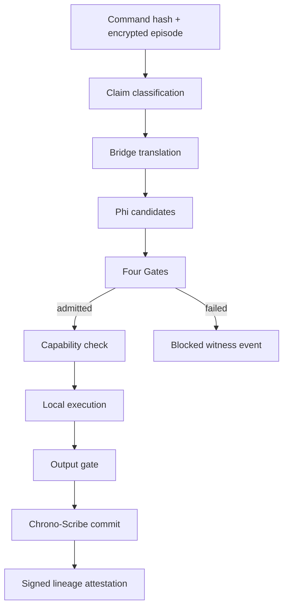

# Layer-by-Layer Build Record

The layers below are ordered by dependency, not mythic prestige. A layer advances only when its executable acceptance evidence passes and a rollback path exists.

## Build sequence

| Layer | Dependency unlocked | Concrete output | Acceptance evidence | State |
|---:|---|---|---|---|
| L0 — Canonicalize | One source hierarchy | Concept registry, claim statuses, evidence states, configuration root | Every executable concept has a plain engineering translation and epistemic label | Complete |
| L1 — State | Durable coordination | One typed/versioned write path, CAS, state history, invariant validators | Invalid coupling, lower ethics lambda, larger recursion cap, identity mutation, and actuation enablement are rejected | Complete |
| L2 — Ledger | Evidence-linked mutation | Append-only hash chain and Merkle root | Payload tampering produces a deterministic verification failure | Complete |
| L3 — Identity | Known-good descent | Stable kernel UUID and Ed25519 lineage | Identity survives restart; every lineage signature and previous hash verifies | Complete |
| L4 — Memory | Recoverable context | Encrypted episodes, local search, deletion tombstones, crystals | Plaintext is absent from SQLite payloads; retrieval works; deletion removes ciphertext; high-signal episodes consolidate | Complete |
| L5 — Bridge | Vision without claim drift | Forge/Temple/Bridge classifier and four seeded contracts | Fireball → safe VOX simulation; shared field → research only; no contract → no Forge authority | Complete |
| L6 — Gates | Fail-closed decisions | Truth, autonomy, harm, integrity, output checks | Harmful real-world request blocks; Gate 8 redirects; all outputs carry mode, evidence, and claim status | Complete |
| L7 — Capabilities | Least-privilege execution | Expiring/revocable token broker | Tool execution is preceded by action/resource authorization; high-risk issuance needs approval; revoked token fails | Complete |
| L8 — Phi–Theta | Bounded alternative selection | Candidate summaries, scores, gate decisions, deterministic selection | Approved simulation outranks generic analysis; blocked candidates cannot be selected; no private chain-of-thought is logged | Complete |
| L9 — Sandboxes | Safe artifacts | Thermal, fictional escalation, procedural geometry, work-plan, and research protocol outputs | All adapters are deterministic, local, reversible, and declare no external effects | Complete |
| L10 — Ouroboros | Controlled improvement | Proposal evaluation, fixed allowed keys, snapshots, re-attestation | Weakening fails; structural change needs approval; accepted change has a rollback snapshot and new lineage record | Complete |
| L11 — Replay / Transparency | Trustworthy-core demo | Deterministic session replay, introspection, composite verification | One session replays to the same output hash; ledger, lineage, state, and SQLite integrity all pass | Complete |
| L12 — CodePet Manifest | File-native project context | Content-hashed bounded manifest and project metadata | Ignored/private paths and symlinks do not enter the manifest; identical content yields the same root | Complete |
| L13 — Typed Change Plan | Reviewable coding change | Create/modify/delete operations, full replacements, expected hashes, unified diff | Traversal, secrets, protected paths, oversized content, duplicate targets, and stale hashes fail closed | Complete |
| L14 — Approval Gate | Attributable authority | Approval record bound to a deterministic change hash | No writes before approval; mutation of covered proposal fields invalidates approval | Complete |
| L15 — Transaction + Tests | Controlled implementation | Affected-file snapshot, atomic write, fixed test profile, result document | Passing change commits; forced failing test restores every affected file | Complete |
| L16 — CodePet Witness | Project-local provenance | Hash-chained JSONL transition journal | Altered event type, payload, previous hash, or event hash is detected | Complete |
| L17 — Provider Boundary | Optional model proposals | Offline fixture provider and consent-gated HTTPS adapter | Host allowlist, no redirects, selected context, secret scan, response limits, local revalidation | Complete |
| L18 — Review Service | Usable local application | Authenticated loopback HTTP API and dashboard | Anonymous mutation denied; full propose/approve/apply lifecycle passes over HTTP | Complete |
| L19 — Schema Migration | Safe release evolution | Database `user_version`, migration history, executable-version monotonicity | Legacy stamp advances; future schema refuses; runtime downgrade rejects | Complete |

## End-to-end command lifecycle



The authorization check occurs before a simulation, memory operation, or analysis renderer is invoked. Raw command text remains inside encrypted CHRYSALIS storage; the ledger records only its hash and decision metadata.

## Verification commands

```bash
python -m unittest discover -s tests -v
python -m loom_verath --data-dir .runtime verify
```

The test suite covers:

- all six buildable invariants;
- stale-write rejection;
- snapshot approval and rollback;
- ledger and lineage tamper detection;
- encrypted memory, retrieval, deletion, and crystallization;
- claim classification and Bridge Contract routing;
- harmful request blocking and safe redirection;
- capability approval and revocation;
- research-only isolation;
- deterministic replay and privacy-preserving logs;
- eval-gated changes and structural approval.
- typed CodePet creation, modification, approval, application, fixed tests, and rollback;
- path traversal, symlink, secret, duplicate-target, staleness, and tamper defenses;
- provider consent, endpoint allowlisting, untrusted-output revalidation, and API authentication;
- legacy database migration and future-schema refusal.

## Deferred layers

| Future layer | Why deferred | Admission condition |
|---|---|---|
| External provider activation | The adapter exists but no provider is configured or called | Choose retention/regional terms, allowlist the endpoint, configure cost/rate limits, and pass live opt-in parity tests |
| Multi-user web deployment | Current bearer-token service is a loopback single-operator tool | Add TLS, durable identities, CSRF strategy, authorization roles, rate limits, reverse-proxy policy, and deployment review |
| Strong OS-isolated test runner | The current runner uses a temporary workspace copy and resource limits, but namespace creation depends on the host | Run tests inside an independently verified network-denied container or microVM with escape tests |
| Vector/graph storage | Local lexical retrieval is enough to test memory governance | Add only with encrypted indexes, deletion propagation, provenance, retrieval evals, and migration tests |
| Multi-instance CHORUS | Consensus magnifies unresolved single-node defects | Single-instance reliability SLO met; explicit Byzantine and partition threat model approved |
| Voice and gesture adapters | Interfaces can collect sensitive biometric or ambient data | Data-minimization contract, explicit consent, local processing, retention controls, and adapter tests |
| External actuation | High-impact irreversible boundary | Separate product, explicit owner authorization, destination binding, sandbox-to-real review, and domain safety assurance |
| Autonomous architecture mutation | Metric gaming and gate self-modification risk | Not admitted. Structural changes remain human-approved and cannot edit the evaluator or weaken invariants |

## Immediate next milestone

The next buildable increment is a deployable OS-isolated runner behind the new pluggable execution boundary. Preserve the temporary-copy and fixed-profile contracts while moving execution into an ephemeral, network-denied container or microVM. Admission requires filesystem escape tests, CPU/memory/time limits, image provenance, deterministic cleanup, and identical result schemas between workspace-copy and isolated execution.
