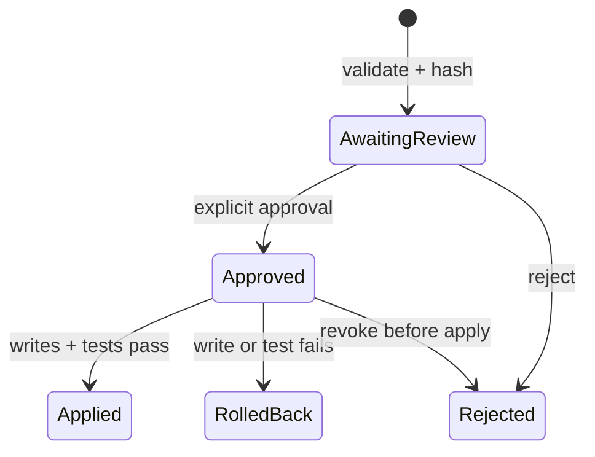

# CodePet controlled development API

**Status:** runnable single-operator prototype. The service is authenticated and loopback-only by default. It is not a multi-user or production security boundary.

## Start the service

```bash
python -m loom_verath pet-serve /absolute/path/to/project
```

The command prints a temporary bearer token and listens on `127.0.0.1:8765`. Open that URL and paste the token into the local dashboard. Supplying a non-loopback host fails unless `--allow-remote` is explicitly set; remote operation still requires a reverse proxy, TLS, authenticated identities, rate limiting, and an independent security review.

## HTTP contract

Every `/api/*` route except `/api/health` requires `Authorization: Bearer <token>`. Mutation bodies must use `Content-Type: application/json`; the request limit is 6 MB.

| Method | Route | Purpose |
|---|---|---|
| `GET` | `/api/health` | Service status without workspace data |
| `GET` | `/api/manifest` | Hash the bounded workspace files |
| `GET` | `/api/proposals` | List proposal identifiers and states |
| `GET` | `/api/proposals/{id}` | Inspect the exact operations, diff, tests, and change hash |
| `GET` | `/api/verify` | Verify proposal hashes and the CodePet journal chain |
| `POST` | `/api/proposals` | Create a typed proposal; performs no workspace write |
| `POST` | `/api/proposals/{id}/approve` | Bind an attributable approval to the exact change hash |
| `POST` | `/api/proposals/{id}/reject` | Remove write/test authority from a pending proposal |
| `POST` | `/api/proposals/{id}/apply` | Snapshot, apply, run fixed tests in a temporary workspace copy, and roll back affected files on failure |

## Proposal lifecycle



Approval covers the immutable `change_hash`, which is computed from the proposal ID, base workspace manifest, typed operations, expected file hashes, replacement hashes, and selected test profiles. Editing any covered field invalidates the proposal.

## Test profiles

Test profiles are exact argument vectors executed in a temporary copy of the bounded workspace with `shell=False`, a timeout, no stdin, truncated/redacted output, a reduced environment that excludes credentials, and `prlimit` resource bounds when available. Test-created side effects therefore do not modify the source workspace.

| Profile | Command or check |
|---|---|
| `workspace-integrity` | Verify the hash-chained CodePet journal |
| `python-compile` | Current interpreter, `-m compileall -q .` |
| `python-unittest` | Current interpreter, `-m unittest discover -s tests -v` |
| `python-pytest` | Current interpreter, `-m pytest -q` |
| `npm-test` | `npm test -- --runInBand` |

The runner probes Bubblewrap rather than trusting its presence. If namespace creation is actually permitted, it selects a network-unshared backend; otherwise it reports `backend: workspace_copy` and `network_os_enforced: false`. On the current build host, Bubblewrap exists but namespace creation is denied. Use `pet-apply ... --require-network-isolation` to fail closed when a network namespace is mandatory. A production runner still needs an independently tested container or microVM boundary.

## Provider boundary

`providers.py` offers a deterministic offline conformance provider and an OpenAI-compatible adapter. External calls require:

- affirmative consent for that call;
- an HTTPS endpoint whose hostname is explicitly allowlisted;
- no redirects, URL credentials, query, or fragment;
- a server-side credential environment variable;
- an explicit set of context files that pass path and secret checks;
- local revalidation of every returned operation.

Provider output creates an `awaiting_review` proposal. It never grants approval or performs a write.
